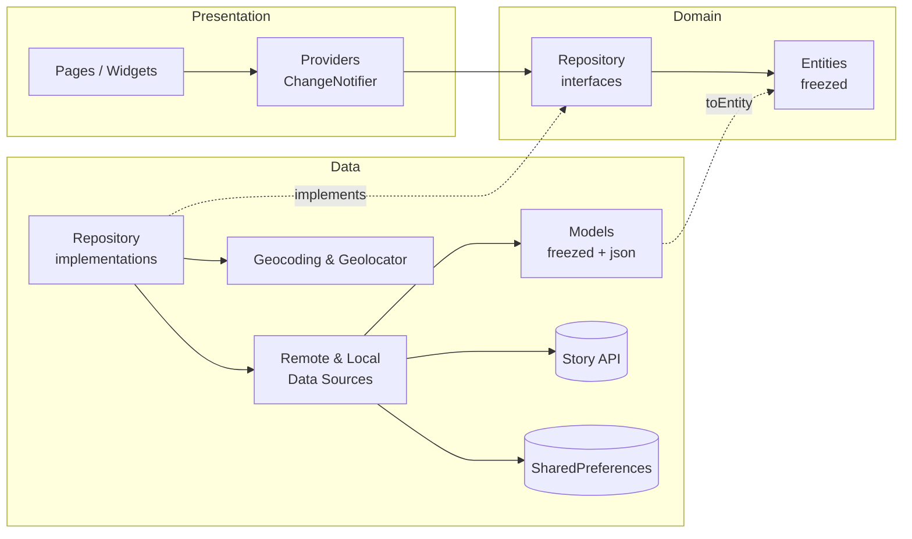
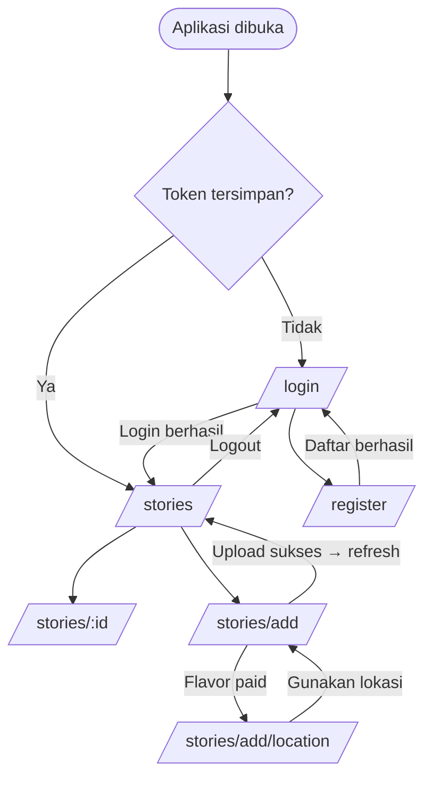

<div align="center">

# 📖 Story App

**Aplikasi berbagi momen belajar di Dicoding — dibangun dengan Flutter, Clean Architecture, Google Maps, dan Build Variant (Free & Paid).**


</div>

---

## 📑 Daftar Isi

1. [Tentang Proyek](#-tentang-proyek)
2. [Tampilan Aplikasi](#-tampilan-aplikasi)
3. [Fitur Utama](#-fitur-utama)
4. [Build Variant: Free vs Paid](#-build-variant-free-vs-paid)
5. [Teknologi & Package](#-teknologi--package)
6. [Arsitektur](#-arsitektur)
7. [Struktur Folder](#-struktur-folder)
8. [Navigasi & Alur Aplikasi](#-navigasi--alur-aplikasi)
9. [Integrasi API](#-integrasi-api)
10. [Persiapan & Cara Menjalankan](#-persiapan--cara-menjalankan)
11. [Konfigurasi Izin Akses (Permission)](#-konfigurasi-izin-akses-permission)
12. [Konfigurasi Google Maps API Key](#-konfigurasi-google-maps-api-key)
13. [Konfigurasi Flavor](#-konfigurasi-flavor)
14. [Code Generation](#-code-generation)
15. [Localization](#-localization)
16. [Build & Rilis](#-build--rilis)
17. [Troubleshooting](#-troubleshooting)
18. [Catatan Keamanan](#-catatan-keamanan)
19. [Pengembang](#-pengembang)

---

## 📌 Tentang Proyek

**Story App** adalah aplikasi mobile untuk menampilkan dan mengunggah momen menarik saat belajar di Dicoding, mirip postingan Instagram yang khusus untuk komunitas Dicoding. Proyek ini adalah **Submission Akhir** kelas *Belajar Pengembangan Aplikasi Flutter Tingkat Lanjut* dan merupakan lanjutan dari submission awal (autentikasi, daftar cerita, tambah cerita, declarative navigation, dan localization).

Pada tahap akhir ini ditambahkan:

- **Google Maps** pada halaman detail dan pada pemilihan lokasi saat menambah cerita.
- **Infinite scrolling pagination** pada daftar cerita.
- **Code generation** (`freezed` + `json_serializable`) untuk seluruh kelas objek.
- **Build variant** `free` dan `paid`.
- **Animasi** (Hero, implicit animation, dan animasi muncul pada kartu cerita).

---

## 📸 Tampilan Aplikasi

> 💡 **Cara mengisi:** simpan screenshot ke folder `docs/screenshots/` lalu sesuaikan nama file pada atribut `src` di bawah ini.
> Ukuran yang disarankan: lebar sekitar 250–300 px per gambar.

### 1. Autentikasi

<table>
  <tr>
    <th align="center">Login</th>
    <th align="center">Register</th>
    <th align="center">Validasi Form</th>
  </tr>
  <tr>
    <td align="center"></td>
    <td align="center"></td>
    <td align="center"></td>
  </tr>
</table>

### 2. Daftar Cerita & Pagination

<table>
  <tr>
    <th align="center">Daftar Cerita</th>
    <th align="center">Loading Halaman Berikutnya</th>
    <th align="center">Data Kosong</th>
    <th align="center">Error + Coba Lagi</th>
  </tr>
  <tr>
    <td align="center"></td>
    <td align="center"></td>
    <td align="center"></td>
    <td align="center"></td>
  </tr>
</table>

### 3. Detail Cerita & Peta

<table>
  <tr>
    <th align="center">Detail Tanpa Lokasi</th>
    <th align="center">Detail Dengan Peta & Marker</th>
    <th align="center">Alamat Saat Marker Ditekan</th>
  </tr>
  <tr>
    <td align="center"></td>
    <td align="center"></td>
    <td align="center"></td>
  </tr>
</table>

### 4. Tambah Cerita

<table>
  <tr>
    <th align="center">Form Tambah Cerita</th>
    <th align="center">Pilih Lokasi di Peta</th>
    <th align="center">Lokasi Terpilih</th>
    <th align="center">Proses Upload</th>
  </tr>
  <tr>
    <td align="center"></td>
    <td align="center"></td>
    <td align="center"></td>
    <td align="center"></td>
  </tr>
</table>

### 5. Build Variant: Free vs Paid

<table>
  <tr>
    <th align="center">Free — Fitur Lokasi Terkunci</th>
    <th align="center">Paid — Fitur Lokasi Aktif</th>
  </tr>
  <tr>
    <td align="center"></td>
    <td align="center"></td>
  </tr>
</table>

### 6. Multi Bahasa (Localization)

<table>
  <tr>
    <th align="center">English</th>
    <th align="center">Bahasa Indonesia</th>
    <th align="center">Menu Pilih Bahasa</th>
  </tr>
  <tr>
    <td align="center"></td>
    <td align="center"></td>
    <td align="center"></td>
  </tr>
</table>

### 7. Animasi (opsional: tambahkan GIF)

<table>
  <tr>
    <th align="center">Hero Animation (List → Detail)</th>
    <th align="center">Animasi Kartu Cerita</th>
  </tr>
  <tr>
    <td align="center"></td>
    <td align="center"></td>
  </tr>
</table>

---

## ✨ Fitur Utama

### 🔐 Autentikasi
- Halaman **Login** dan **Register** dengan validasi form (format email, nama wajib diisi, password minimal 8 karakter).
- Karakter password **disembunyikan** (`obscureText`) dengan tombol tampilkan/sembunyikan.
- Sesi dan token disimpan di **SharedPreferences** (`userId`, `name`, `token`). **Password tidak pernah disimpan.**
- Alur otomatis: sudah login → langsung ke daftar cerita; belum login → halaman login.
- **Logout** menghapus token dan sesi, lalu otomatis kembali ke halaman login.

### 📰 Cerita
- Daftar cerita dari **Story API** berisi nama pengguna, foto, dan deskripsi singkat.
- **Infinite scrolling pagination** memakai parameter `page` dan `size`; spinner tampil di bagian bawah saat memuat halaman berikutnya, tanpa data duplikat.
- **Pull-to-refresh**.
- Penanganan state: **loading**, **error** (dengan tombol coba lagi), dan **data kosong**.
- Gambar di-cache memakai `CachedNetworkImage`.
- **Halaman detail** menampilkan nama, foto, tanggal, deskripsi, dan **peta dengan marker** apabila cerita memiliki koordinat. Menekan marker menampilkan **alamat hasil geocoding**.

### ➕ Tambah Cerita
- Ambil foto dari **kamera** atau **galeri** (`image_picker`), dengan validasi ukuran maksimal **1 MB**.
- Input deskripsi dengan validasi.
- **Pilih lokasi lewat Google Maps**: ketuk peta untuk menaruh marker, marker dapat digeser, alamat tampil secara langsung, dan tersedia tombol *lokasi saya*.
- Unggah memakai **multipart request** beserta `lat` dan `lon`.
- Setelah sukses, aplikasi kembali ke halaman utama, daftar **di-refresh**, dan cerita baru muncul di **paling atas**.

### 🌐 Lainnya
- **Localization** Bahasa Indonesia dan Inggris, pilihan bahasa tersimpan.
- **Declarative navigation** dengan `go_router`, termasuk *redirect* berdasarkan status login.
- **Animasi**: Hero (foto), animasi muncul pada kartu, `AnimatedSwitcher` dan `AnimatedSize`.
- Tema **Material 3**, layout responsif (konten dibatasi lebar maksimum pada layar besar).

---

## 💎 Build Variant: Free vs Paid

Aplikasi memiliki dua *flavor* yang dapat terpasang bersamaan di perangkat (berbeda `applicationId`).

| Kemampuan | `free` | `paid` |
|---|:---:|:---:|
| Login, register, logout | ✅ | ✅ |
| Daftar cerita + pagination | ✅ | ✅ |
| Detail cerita + peta (jika ada lokasi) | ✅ | ✅ |
| Tambah cerita (foto + deskripsi) | ✅ | ✅ |
| **Menambahkan lokasi saat membuat cerita** | 🔒 Terkunci | ✅ |
| Nama aplikasi | Story App Free | Story App Paid |
| Application ID | `<package>.free` | `<package>.paid` |

Flavor dibaca di Dart melalui `appFlavor` (`lib/core/config/app_flavor.dart`). Jika aplikasi dijalankan tanpa `--flavor`, perilakunya sama dengan `free`. Lokasi juga **tidak dikirim** ke API pada flavor `free`, walaupun UI berhasil dimanipulasi.

---

## 🧰 Teknologi & Package

**Bahasa & framework:** Dart, Flutter (Material 3)

| Kategori | Package | Kegunaan |
|---|---|---|
| State management | [`provider`](https://pub.dev/packages/provider) | Memisahkan logika bisnis dari UI (`ChangeNotifier`) |
| Navigasi | [`go_router`](https://pub.dev/packages/go_router) | Declarative navigation, redirect otomatis, `extra` antar halaman |
| Jaringan | [`http`](https://pub.dev/packages/http) | GET/POST JSON dan multipart upload |
| Penyimpanan lokal | [`shared_preferences`](https://pub.dev/packages/shared_preferences) | Sesi (token) dan pilihan bahasa |
| Gambar | [`cached_network_image`](https://pub.dev/packages/cached_network_image) | Cache dan placeholder gambar |
| Media | [`image_picker`](https://pub.dev/packages/image_picker) | Ambil foto dari kamera/galeri |
| Peta | [`google_maps_flutter`](https://pub.dev/packages/google_maps_flutter) | Peta dan marker |
| Geocoding | [`geocoding`](https://pub.dev/packages/geocoding) | Koordinat → alamat (reverse geocoding) |
| Lokasi | [`geolocator`](https://pub.dev/packages/geolocator) | Posisi perangkat dan izin lokasi |
| Code generation | [`freezed`](https://pub.dev/packages/freezed), [`freezed_annotation`](https://pub.dev/packages/freezed_annotation) | Kelas immutable, `copyWith`, equality |
| Serialisasi JSON | [`json_serializable`](https://pub.dev/packages/json_serializable), [`json_annotation`](https://pub.dev/packages/json_annotation) | `fromJson` / `toJson` |
| Build runner | [`build_runner`](https://pub.dev/packages/build_runner) | Menjalankan code generator |
| Localization | `flutter_localizations`, [`intl`](https://pub.dev/packages/intl) | Multi bahasa dan format tanggal |
| Lint | [`flutter_lints`](https://pub.dev/packages/flutter_lints) | Standar kualitas kode |

> Versi persisnya ada di [`pubspec.yaml`](pubspec.yaml) dan [`pubspec.lock`](pubspec.lock).

**Layanan eksternal:** [Dicoding Story API](https://story-api.dicoding.dev/v1/), Google Maps Platform (Maps SDK), layanan geocoding bawaan Android/iOS.

---

## 🏗️ Arsitektur

Proyek memakai **Clean Architecture (Layered Architecture)** dengan tiga lapisan. Ketergantungan hanya mengarah ke dalam: *Presentation → Domain ← Data*.



| Lapisan | Tanggung jawab |
|---|---|
| **Presentation** | UI (pages, widgets) dan `ChangeNotifier` provider yang menyimpan state layar (loading/success/empty/error). |
| **Domain** | Entity murni (`Story`, `UserSession`, `GeoPoint`) dan kontrak repository (abstract class). Tidak bergantung pada Flutter UI maupun package jaringan. |
| **Data** | Implementasi repository, data source (API & lokal), dan model JSON yang dikonversi ke entity lewat `toEntity()`. |
| **Core** | Konfigurasi flavor, konstanta, `ApiClient`, exception, router, validator, utilitas. |

**Keputusan desain penting**

- **Provider per halaman** (`ChangeNotifierProvider` di dalam route) agar state dibuang saat halaman ditutup. Contohnya, daftar cerita pengguna lama tidak bocor ke pengguna berikutnya setelah logout.
- **`SafeChangeNotifier`** mencegah error *"used after dispose"* bila request selesai setelah pengguna meninggalkan halaman.
- **Pagination aman** dari data duplikat (penyaringan berdasarkan `id`) dan dari respons usang (penanda *generation* saat refresh).
- **Hero + `extra`**: item yang ditekan dikirim lewat `extra` sehingga detail langsung tampil, lalu disegarkan dari API.

---

## 🗂️ Struktur Folder

```
lib/
├── main.dart                         # Dependency injection manual + runApp
├── app.dart                          # MaterialApp.router, tema, localization
├── core/
│   ├── config/app_flavor.dart        # Deteksi flavor free / paid
│   ├── constants/api_constants.dart  # Base URL, timeout, page size, batas ukuran gambar
│   ├── error/app_exception.dart      # ApiException, NetworkException
│   ├── network/api_client.dart       # HTTP client (JSON + multipart) dan mapping error
│   ├── router/app_router.dart        # Daftar route & redirect berbasis sesi
│   └── utils/
│       ├── safe_change_notifier.dart
│       ├── validators.dart
│       └── view_state.dart
├── domain/
│   ├── entities/                     # geo_point, story, user_session   (freezed)
│   └── repositories/                 # auth_, story_, location_repository (abstract)
├── data/
│   ├── datasources/                  # auth_local, auth_remote, story_remote
│   ├── models/                       # story_model, user_session_model  (freezed + json)
│   └── repositories/                 # auth_, story_, location_repository_impl
├── presentation/
│   ├── pages/                        # login, register, story_list, story_detail,
│   │                                 # add_story, pick_location
│   ├── providers/                    # auth, locale, story_list, story_detail,
│   │                                 # add_story, pick_location
│   └── widgets/                      # story_card, story_location_map, location_selector,
│                                     # password_form_field, loading_button,
│                                     # message_view, language_menu_button
└── l10n/
    ├── app_en.arb
    ├── app_id.arb
    └── l10n_extension.dart
```

File `*.freezed.dart`, `*.g.dart`, dan `app_localizations*.dart` adalah **hasil generate** (lihat [Code Generation](#-code-generation)).

---

## 🧭 Navigasi & Alur Aplikasi

| Route | Halaman | Keterangan |
|---|---|---|
| `/login` | `LoginPage` | Hanya untuk pengguna belum login |
| `/register` | `RegisterPage` | Dibuka dari halaman login |
| `/stories` | `StoryListPage` | Halaman utama (daftar cerita) |
| `/stories/add` | `AddStoryPage` | Form tambah cerita |
| `/stories/add/location` | `PickLocationPage` | Pilih lokasi lewat peta (hanya flavor `paid`) |
| `/stories/:id` | `StoryDetailPage` | Detail cerita (+ peta jika ada lokasi) |



**Perilaku tombol Back yang benar**

- Setelah login, Back tidak kembali ke halaman login (di-*redirect* oleh router, bukan di-*push*).
- Setelah upload sukses, Back tidak kembali ke form upload.
- Setelah logout, Back tidak kembali ke halaman utama.

---

## 🌍 Integrasi API

Base URL: `https://story-api.dicoding.dev/v1`
Dokumentasi: <https://story-api.dicoding.dev/v1/>

| Fitur | Method | Endpoint | Catatan |
|---|:---:|---|---|
| Register | `POST` | `/register` | `name`, `email`, `password` (min. 8 karakter) |
| Login | `POST` | `/login` | Mengembalikan `loginResult` (userId, name, token) |
| Daftar cerita | `GET` | `/stories?page={n}&size={n}&location=0` | Header `Authorization: Bearer <token>` |
| Detail cerita | `GET` | `/stories/:id` | Header `Authorization: Bearer <token>` |
| Tambah cerita | `POST` | `/stories` | `multipart/form-data`: `description`, `photo`, opsional `lat`, `lon` |

> ⚠️ Endpoint **guest** (`/stories/guest`) **tidak digunakan**. Data pada Story API otomatis dihapus setelah satu jam.

---

## 🚀 Persiapan & Cara Menjalankan

### Prasyarat

- [Flutter SDK](https://docs.flutter.dev/get-started/install) (sesuai constraint `environment.sdk` pada `pubspec.yaml`)
- Android Studio / VS Code dengan plugin Flutter & Dart
- Emulator atau perangkat fisik (**disarankan emulator dengan *Google APIs / Play Store*** agar peta dan geocoding berfungsi)
- Google Maps API key (lihat [bagian konfigurasi](#-konfigurasi-google-maps-api-key))

Cek lingkungan Anda:

```bash
flutter doctor
```

### Langkah-langkah

```bash
# 1. Clone repository
git clone https://github.com/<username>/<nama-repository>.git
cd <nama-repository>

# 2. Unduh dependensi (sekaligus men-generate file localization)
flutter pub get

# 3. Jalankan code generation (freezed + json_serializable)
dart run build_runner build --delete-conflicting-outputs

# 4. Isi Google Maps API key di android/app/src/main/AndroidManifest.xml
#    (lihat bagian "Konfigurasi Google Maps API Key")

# 5. Jalankan aplikasi dengan flavor yang diinginkan
flutter run --flavor free
flutter run --flavor paid
```

> Jika file localization belum ter-generate, jalankan `flutter gen-l10n`.

### Menjalankan dari IDE

- **Android Studio:** pilih konfigurasi `free` atau `paid` pada dropdown run (tersedia di `.idea/runConfigurations`), lalu tekan ▶️.
- **VS Code:** pilih `free` atau `paid` pada panel *Run and Debug* (`.vscode/launch.json`).

### Akun uji

Buat akun baru lewat halaman **Register** (email harus unik, password minimal 8 karakter), lalu login.

---

## 🔑 Konfigurasi Izin Akses (Permission)

### Android — `android/app/src/main/AndroidManifest.xml`

```xml
<manifest xmlns:android="http://schemas.android.com/apk/res/android">

    <!-- Akses internet untuk Story API dan Google Maps -->
    <uses-permission android:name="android.permission.INTERNET"/>

    <!-- Lokasi perangkat (tombol "lokasi saya" pada pilih lokasi) -->
    <uses-permission android:name="android.permission.ACCESS_FINE_LOCATION"/>
    <uses-permission android:name="android.permission.ACCESS_COARSE_LOCATION"/>

    <application android:label="@string/app_name" ...>
        <meta-data
            android:name="com.google.android.geo.API_KEY"
            android:value="GANTI_DENGAN_API_KEY_ANDA"/>
        ...
    </application>
</manifest>
```

| Permission | Digunakan untuk |
|---|---|
| `INTERNET` | Memanggil Story API, memuat gambar, dan tile Google Maps |
| `ACCESS_FINE_LOCATION` / `ACCESS_COARSE_LOCATION` | Mengambil posisi perangkat saat memilih lokasi |
| Kamera & galeri | Ditangani otomatis oleh `image_picker` (izin diminta saat dipakai) |

### iOS — `ios/Runner/Info.plist`

```xml
<key>NSCameraUsageDescription</key>
<string>Dibutuhkan untuk mengambil foto cerita</string>
<key>NSPhotoLibraryUsageDescription</key>
<string>Dibutuhkan untuk memilih foto cerita dari galeri</string>
<key>NSLocationWhenInUseUsageDescription</key>
<string>Dibutuhkan untuk menentukan lokasi cerita</string>
```

Pada `ios/Runner/AppDelegate.swift`:

```swift
import GoogleMaps
// di dalam didFinishLaunchingWithOptions, sebelum GeneratedPluginRegistrant.register:
GMSServices.provideAPIKey("GANTI_DENGAN_API_KEY_ANDA")
```

Pada `ios/Podfile`: `platform :ios, '14.0'`.

---

## 🗺️ Konfigurasi Google Maps API Key

1. Buka [Google Cloud Console](https://console.cloud.google.com/) dan buat/pilih project.
2. Aktifkan **Maps SDK for Android** (dan **Maps SDK for iOS** bila perlu).
3. Buat **API key** pada menu *APIs & Services → Credentials*.
4. Tempelkan key ke `AndroidManifest.xml` (nilai `com.google.android.geo.API_KEY`).
5. **Batasi key** (*Application restrictions*) ke package berikut beserta SHA-1 sertifikat Anda:
   - `<package-name>.free`
   - `<package-name>.paid`

> Tanpa API key yang valid, peta akan tampil **kosong/abu-abu**.

---

## 🏷️ Konfigurasi Flavor

### Android — `android/app/build.gradle.kts`

```kotlin
android {
    flavorDimensions += "tier"
    productFlavors {
        create("free") {
            dimension = "tier"
            applicationIdSuffix = ".free"
            resValue("string", "app_name", "Story App Free")
        }
        create("paid") {
            dimension = "tier"
            applicationIdSuffix = ".paid"
            resValue("string", "app_name", "Story App Paid")
        }
    }
}
```

### Perintah

```bash
flutter run --flavor free
flutter run --flavor paid
flutter build apk --flavor free
flutter build apk --flavor paid
```

### iOS (opsional)

Buat konfigurasi `Debug-free`, `Release-free`, `Profile-free`, `Debug-paid`, `Release-paid`, `Profile-paid` di Xcode, lalu buat scheme `free` dan `paid` yang mengarah ke konfigurasi tersebut. Nama scheme **harus sama persis** dengan nama flavor.

---

## ⚙️ Code Generation

Seluruh kelas objek memakai code generation:

| Kelas | Lapisan | Generator |
|---|---|---|
| `Story`, `UserSession`, `GeoPoint` | Domain (entity) | `freezed` |
| `StoryModel`, `UserSessionModel` | Data (model) | `freezed` + `json_serializable` |

```bash
# sekali jalan
dart run build_runner build --delete-conflicting-outputs

# mode watch saat pengembangan
dart run build_runner watch --delete-conflicting-outputs
```

Hasil: `*.freezed.dart` dan `*.g.dart` di samping file sumber. File hasil generate **tidak dihapus oleh `flutter clean`** dan sebaiknya ikut di-commit agar proyek langsung bisa di-build setelah clone. Opsional, tambahkan pada `analysis_options.yaml`:

```yaml
analyzer:
  exclude:
    - "**/*.g.dart"
    - "**/*.freezed.dart"
```

---

## 🌐 Localization

- Bahasa: **English (`en`)** dan **Bahasa Indonesia (`id`)**.
- Sumber string: `lib/l10n/app_en.arb` dan `lib/l10n/app_id.arb`; konfigurasi pada `l10n.yaml`.
- Akses di kode lewat extension: `context.l10n.namaString`.
- Pilihan bahasa dapat diganti dari ikon 🌐 di AppBar dan **tersimpan** di SharedPreferences. Saat belum dipilih, aplikasi mengikuti bahasa perangkat.

Menambah bahasa baru: buat `app_xx.arb`, salin semua key dari `app_en.arb`, lalu jalankan `flutter gen-l10n`.

---

## 📦 Build & Rilis

```bash
# APK
flutter build apk --release --flavor paid

# Android App Bundle
flutter build appbundle --release --flavor paid
```

Sebelum mengirim proyek / membuat arsip ZIP:

```bash
flutter clean
```

Lalu kompres proyek **tanpa menjalankan/build lagi**. Pastikan file hasil generate (`*.g.dart`, `*.freezed.dart`) tetap ada.

---

## 🩺 Troubleshooting

| Masalah | Penyebab & Solusi |
|---|---|
| `The method 'placemarkFromCoordinates' isn't defined` | `geocoding` **v5.0.0** memindahkan semua fungsi ke kelas `Geocoding`. Gunakan `Geocoding().placemarkFromCoordinates(lat, lon)` (sudah dipakai di proyek ini). |
| Error `Target of URI doesn't exist: ...freezed.dart / .g.dart` | Code generation belum dijalankan. Jalankan `dart run build_runner build --delete-conflicting-outputs`. |
| Error `app_localizations.dart` tidak ditemukan | Pastikan `generate: true` ada di bagian `flutter:` pada `pubspec.yaml`, lalu `flutter pub get` atau `flutter gen-l10n`. |
| Peta tampil kosong/abu-abu | API key belum diisi/salah, Maps SDK belum diaktifkan, atau restriksi key tidak cocok dengan package `.free`/`.paid`. |
| Alamat marker menampilkan "Alamat tidak tersedia" | Emulator tanpa Google Play Services atau tidak ada internet. Gunakan emulator *Google APIs* atau perangkat asli. Koordinat tetap ditampilkan sebagai cadangan. |
| `No flavor` / `The Gradle project does not define a task` | Jalankan dengan `--flavor free` atau `--flavor paid`, dan pastikan `productFlavors` sudah ditambahkan. |
| Tombol lokasi terkunci di aplikasi | Itu perilaku flavor `free`. Jalankan dengan `--flavor paid`. |
| Foto ditolak "maksimal 1 MB" | Batas dari Story API. Pilih foto lain atau yang lebih kecil. |
| Cerita lama tidak punya peta | Cerita tanpa `lat`/`lon` memang tidak menampilkan peta. Buat cerita baru dengan flavor `paid` untuk menguji. |
| `flutter run` gagal setelah ganti versi paket | Jalankan `flutter clean && flutter pub get`, lalu build_runner ulang. |

---

## 🔒 Catatan Keamanan

- **Password tidak disimpan** di perangkat. Hanya `userId`, `name`, dan `token` yang disimpan di SharedPreferences.
- Jangan membagikan **Google Maps API key** tanpa pembatasan. Pada repository publik, batasi key berdasarkan package name + SHA-1, atau simpan di luar version control (mis. lewat `local.properties` / `manifestPlaceholders`).
- Token Story API dikirim lewat header `Authorization: Bearer`.

---

## 👤 Pengembang

**Nama Anda** — [@username-github](https://github.com/username-github)

Proyek ini dibuat sebagai bagian dari submission kelas **Belajar Pengembangan Aplikasi Flutter Tingkat Lanjut** di [Dicoding](https://www.dicoding.com/).

## 📄 Lisensi

Ditujukan untuk keperluan pembelajaran. Tambahkan lisensi pilihan Anda (mis. MIT) pada file `LICENSE` bila diperlukan.

---

<div align="center">

⭐ Jika proyek ini bermanfaat, jangan lupa beri **star** pada repository ini.

</div>